# 衣镜 Studio · 演示素材

「衣镜 Studio」电商服饰 AI 视觉工作台的演示截图与视频，主项目：

- GitHub：https://github.com/fantaowang079-jpg/ai-fashion-visual
- Gitee：https://gitee.com/zjlhslyjsf0036/ai-fashion-visual

## 1. 模特生图

| 变装前 | 变装后 |
|---|---|
| 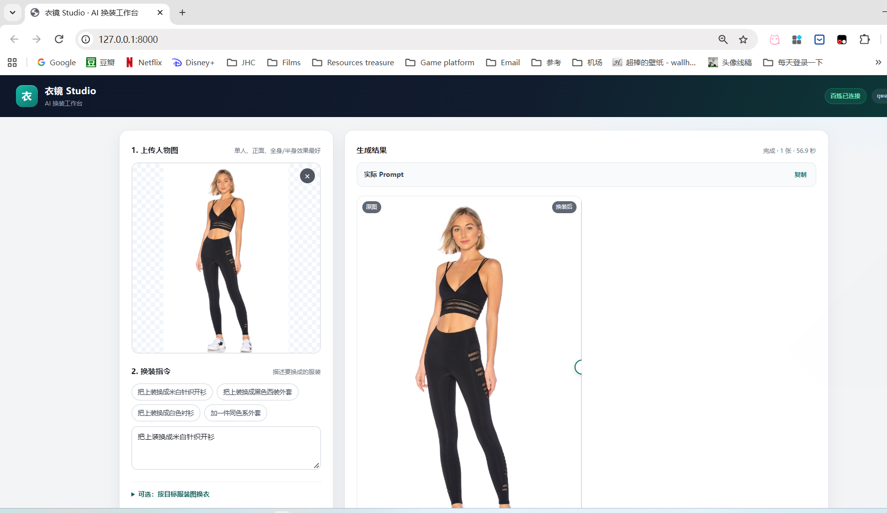 | 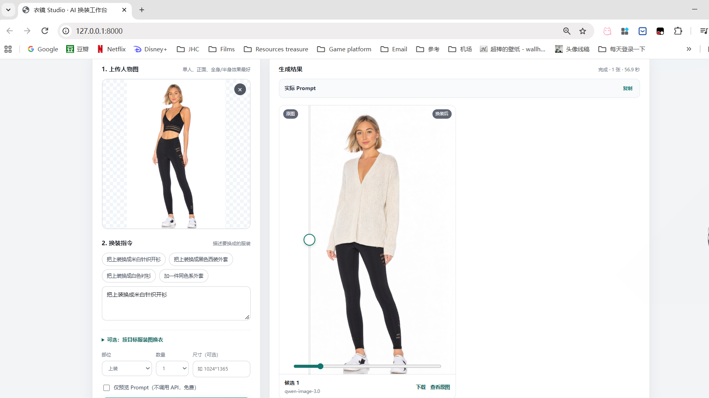 |

| 变装前（3 毛） | 变装后（3 毛） |
|---|---|
| 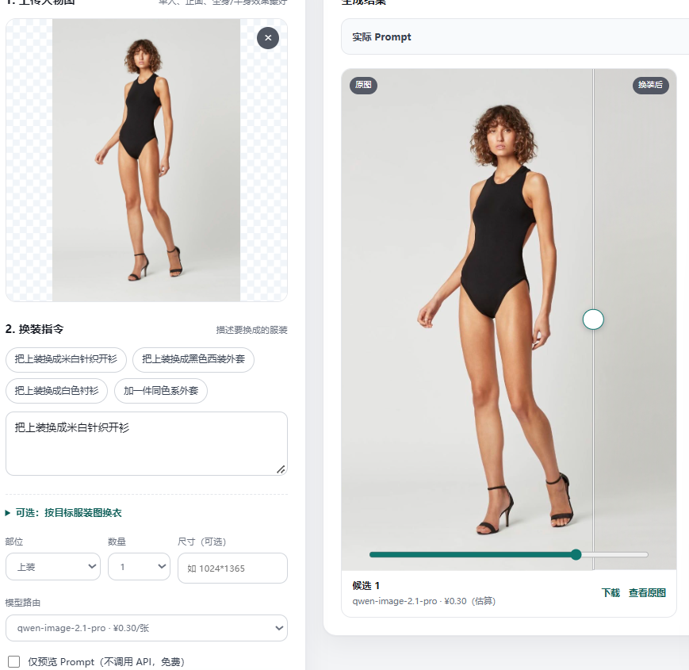 | 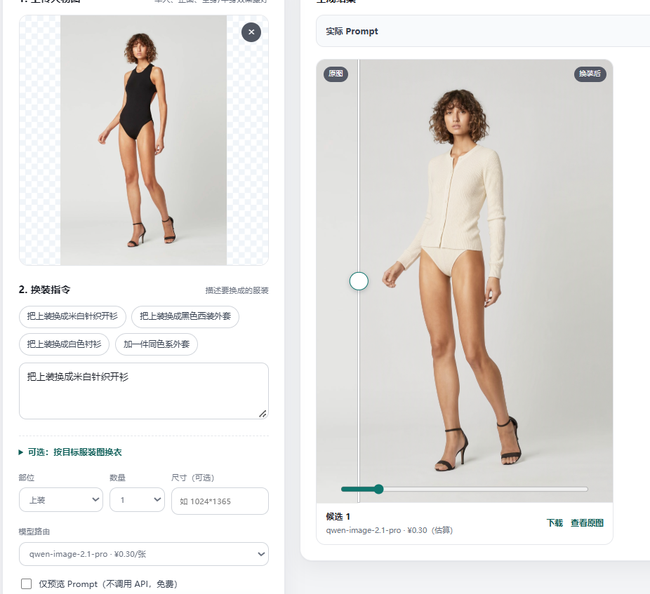 |

## 2. 模特换衣服

| 换装前 | 换装后 |
|---|---|
| 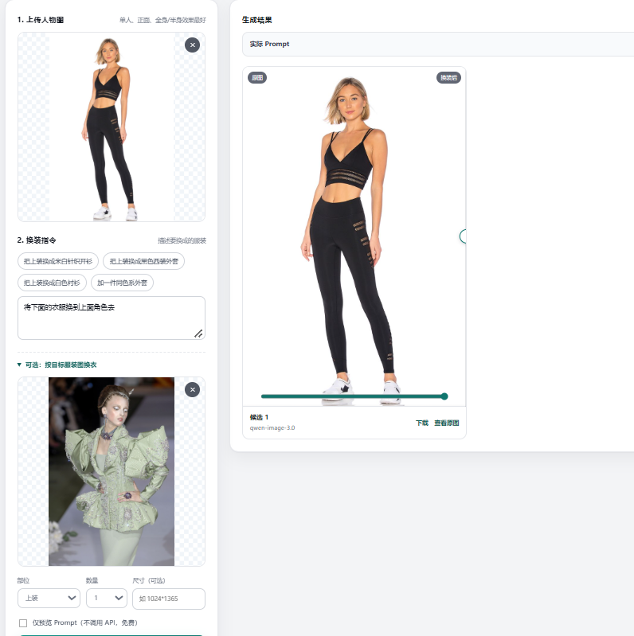 | 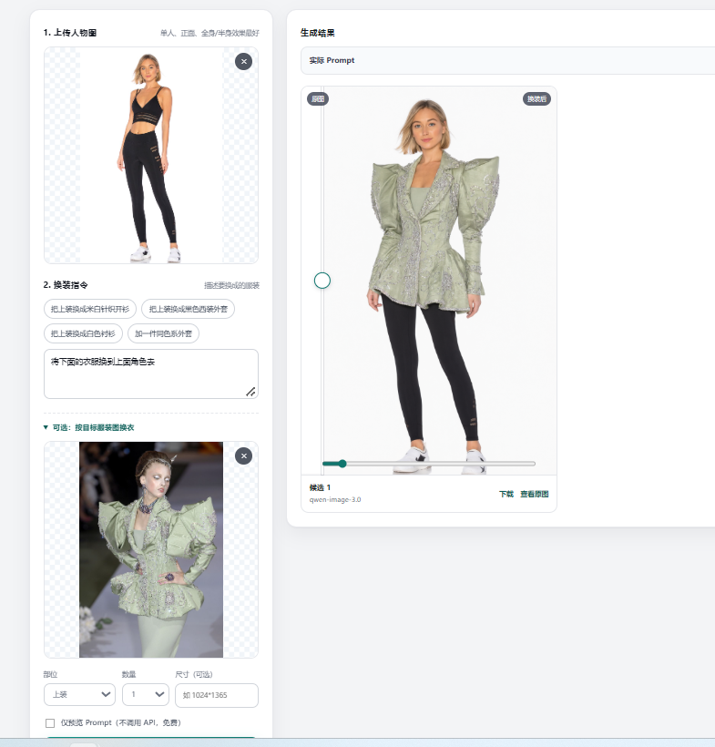 |

## 3. 调用费用显示

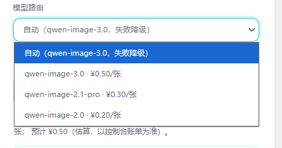

## 4. 虚拟试衣

| 试衣前 | 试衣后 |
|---|---|
| 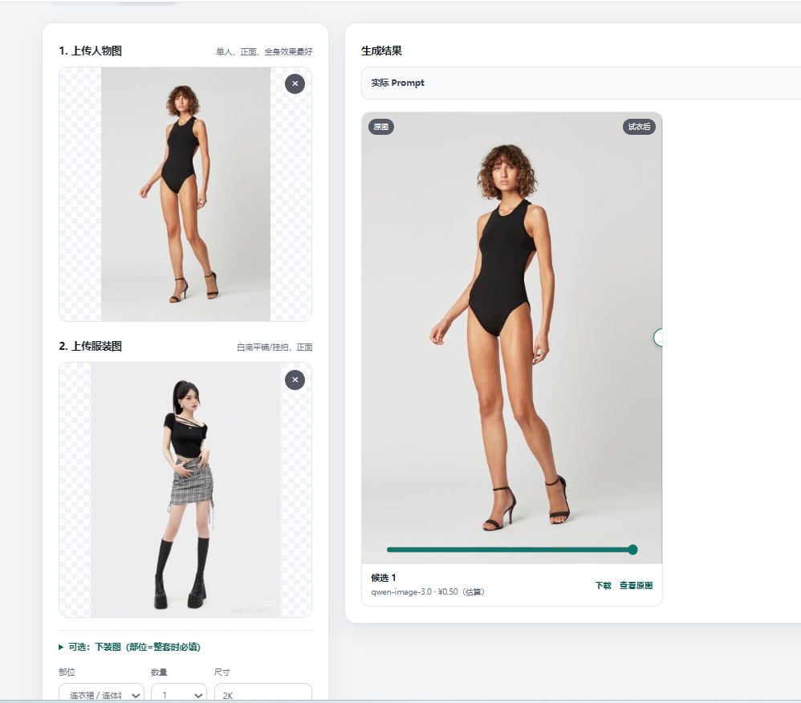 | 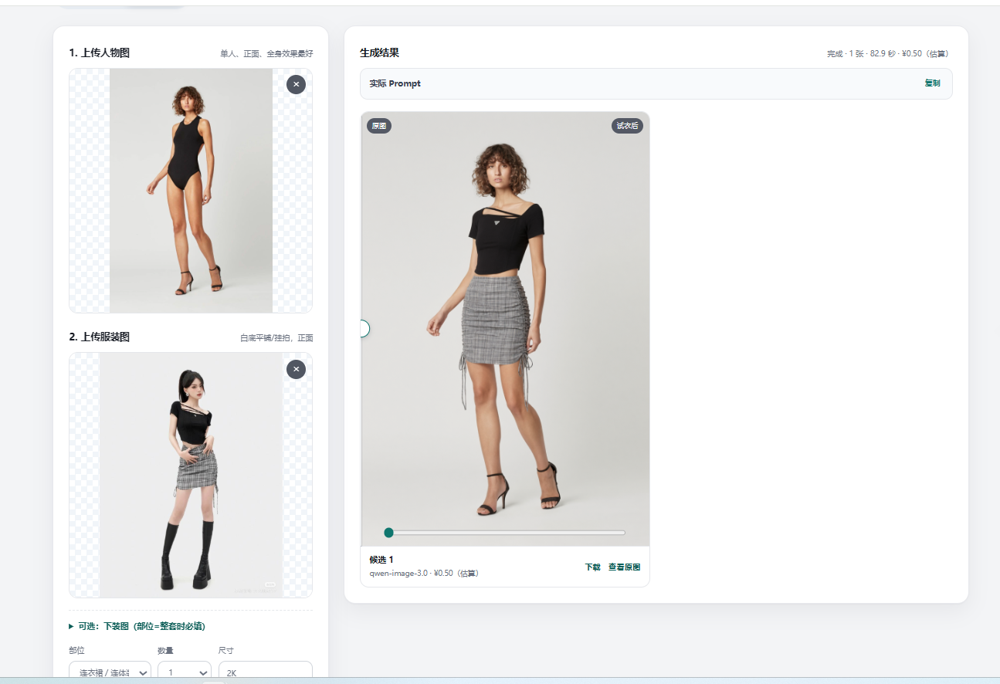 |

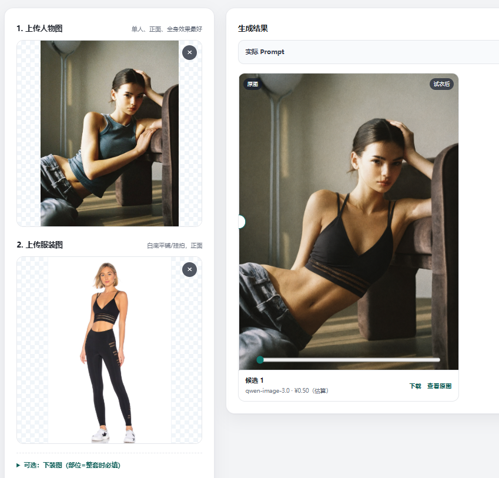

## 5. 历史记录

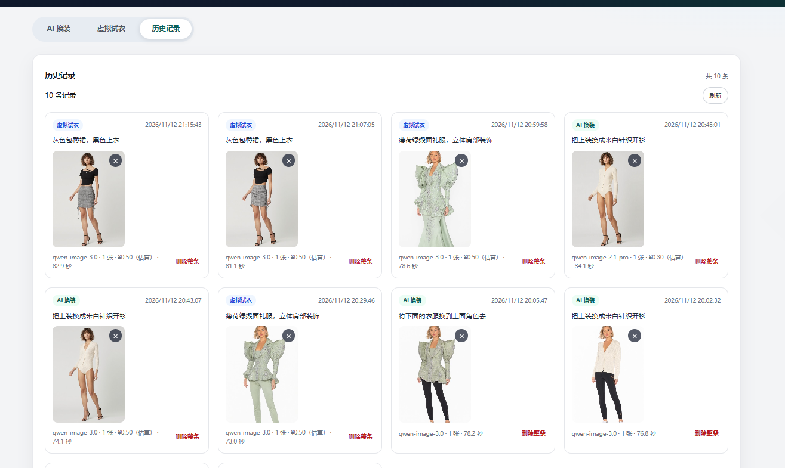

## 6. 智能穿搭

| 穿搭方案 | Prompt |
|---|---|
| 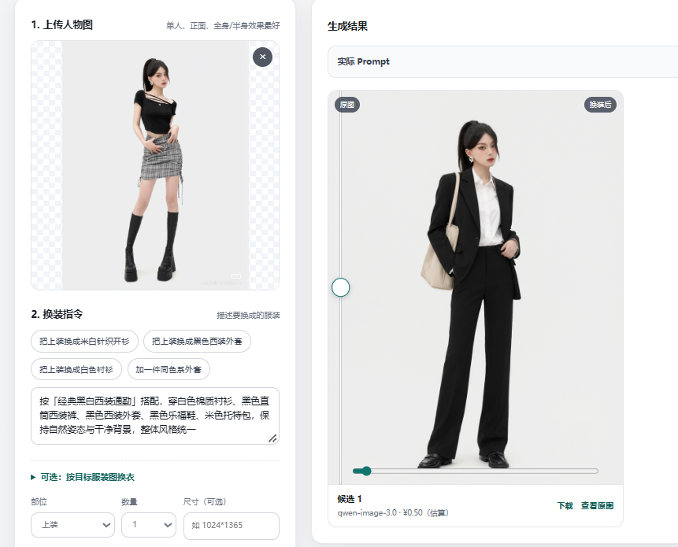 | 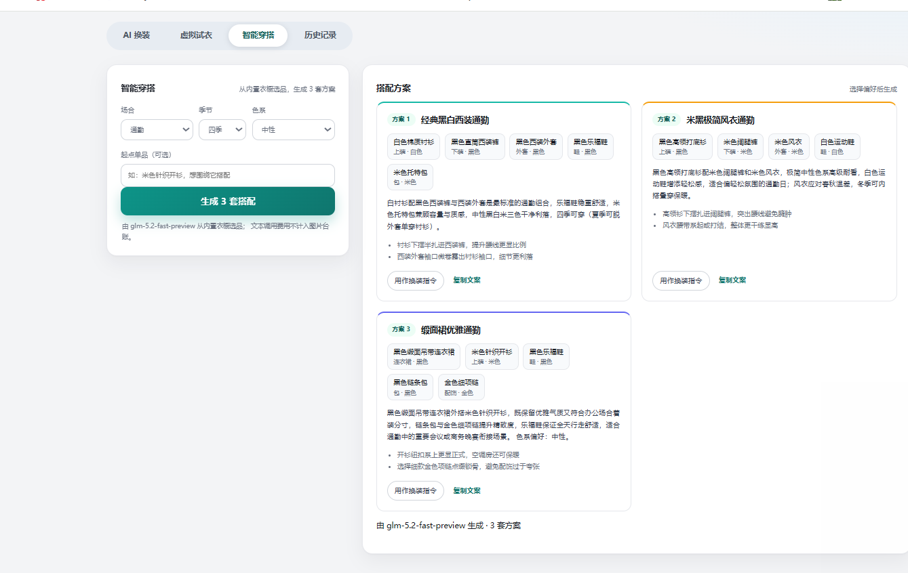 |

## 7. 图生视频

[播放演示视频](演示图1/7图生视频展示/1.mp4)

---

> 演示素材仅用于项目展示；生成内容为 AI 合成，服装细节可能与实物存在差异。
